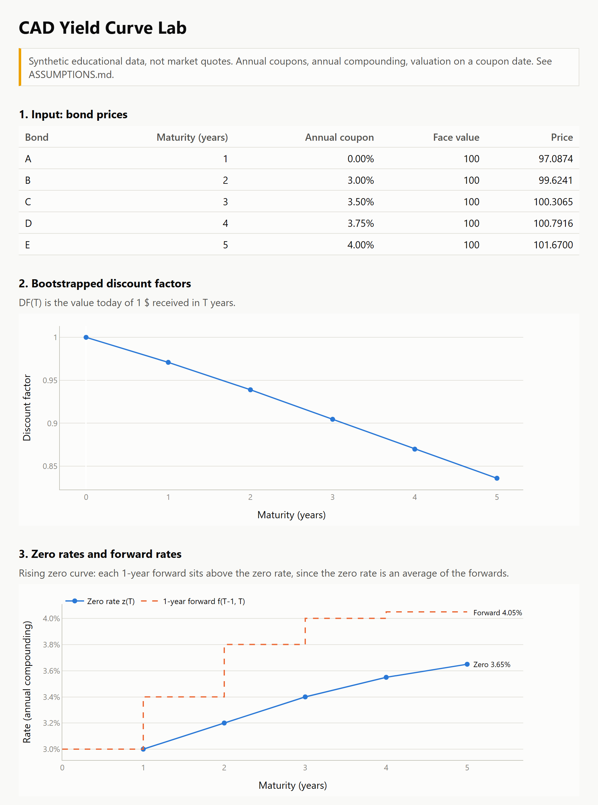
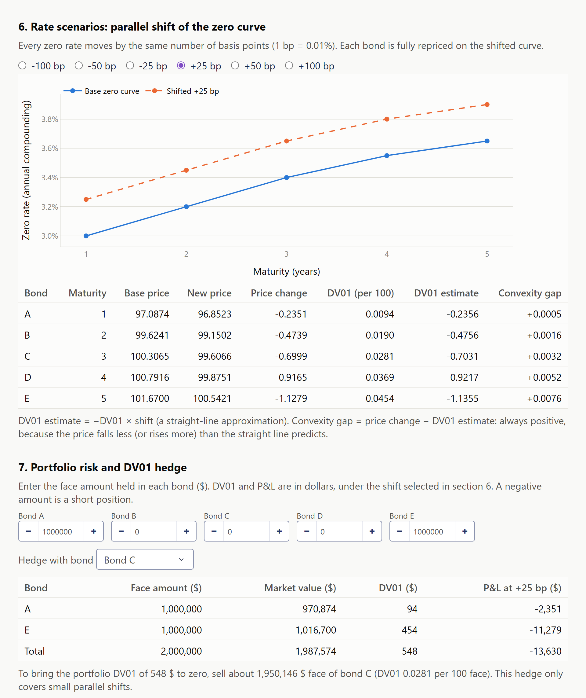
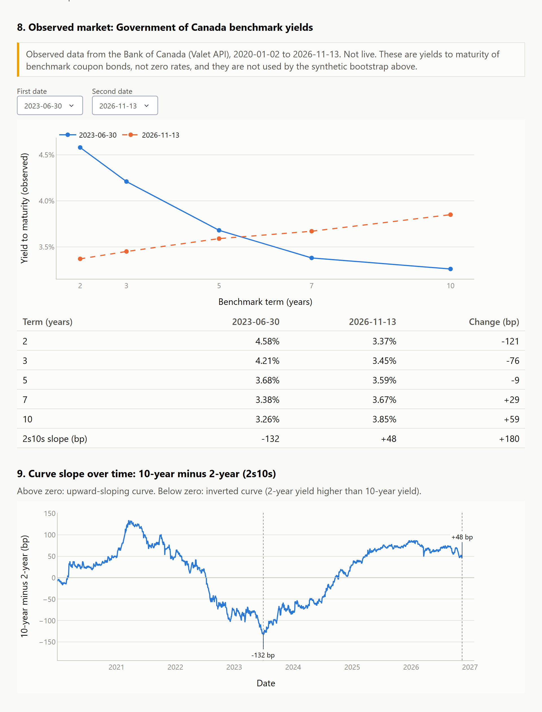

# CAD Yield Curve Lab

A Python project that **bootstraps an interest rate curve from bond prices**, measures **interest rate risk** (scenarios, DV01, convexity, hedging), and explores **observed Government of Canada yields** from the Bank of Canada, all in an interactive **Dash** dashboard.

It is a personal learning project in fixed income. The goal is transparency: every formula is implemented by hand, tested, and documented, rather than hidden inside a pricing library.

> **Data honesty.** The bootstrap runs on a **synthetic** bond dataset, built from a known reference curve so the algorithm can be checked against the right answer. The market section uses **observed** Bank of Canada data saved to a file (2020-01-02 to 2026-11-13); it is **not live**. The simplified single-curve method is educational and is not the multi-curve construction used by trading desks.



---

## What the dashboard shows

| Section | Content |
|---|---|
| 1. Input | Five synthetic bonds: maturity, annual coupon, price per 100 face |
| 2–4. Curve | Bootstrapped discount factors, zero rates and one-year forward rates |
| 5. Price breakdown | A bond's price, cash flow by cash flow |
| 6. Rate scenarios | Parallel shifts of ±25, ±50, ±100 bp; full repricing vs the DV01 straight line (convexity gap) |
| 7. Portfolio | Face amount per bond, portfolio DV01 and P&L in dollars, DV01 hedge size |
| 8–9. Observed market | Government of Canada benchmark yields on two dates, change in bp, and the 2s10s slope since 2020 |





---

## Method

Conventions (see [ASSUMPTIONS.md](ASSUMPTIONS.md)): CAD, face value 100, annual coupons, annual compounding, integer maturities, valuation on a coupon date (clean price = dirty price), rates stored as decimals.

**Pricing.** A bond is a list of cash flows; its price is their present value:

$$P = \sum_t CF(t)\,DF(t)$$

**Bootstrapping.** Bonds are processed from shortest to longest maturity. For a bond maturing at $T$, every discount factor before $T$ is already known, so only $DF(T)$ is unknown:

$$DF(T) = \frac{P - \sum_{t<T} CF(t)\,DF(t)}{CF(T)}$$

**Zero and forward rates** (annual compounding):

$$z(T) = DF(T)^{-1/T} - 1 \qquad f(T_1,T_2) = \left(\frac{DF(T_1)}{DF(T_2)}\right)^{1/(T_2-T_1)} - 1$$

**Scenarios.** A shock of $s$ basis points is applied to **every zero rate** (not to each bond's yield), so every bond is repriced with one consistent set of discount factors:

$$z'(T) = z(T) + s \times 0.0001$$

**DV01** by finite difference: $\text{DV01} = P(\text{base}) - P(\text{curve} + 1\text{ bp})$. It is linear; large shocks are always computed by full repricing, and the difference shows the convexity.

**Hedge.** Face amount of the hedge bond to sell so that the portfolio DV01 is zero:

$$\text{face} = \frac{\text{DV01}_\text{portfolio}}{\text{DV01 of the hedge per 100}} \times 100$$

---

## Results

**Bootstrap on synthetic data.** The algorithm recovers the reference curve within 0.1 bp (prices are rounded to 4 decimals) and reprices every bond to 1e-10.

| Maturity | Discount factor | Zero rate | Forward f(T−1, T) |
|---|---|---|---|
| 1 | 0.970874 | 3.00% | 3.00% |
| 2 | 0.938946 | 3.20% | 3.40% |
| 3 | 0.904562 | 3.40% | 3.80% |
| 4 | 0.869761 | 3.55% | 4.00% |
| 5 | 0.835898 | 3.65% | 4.05% |

Repricing alone does not prove the bootstrap: it is exact by construction. The independent check is the recovery of the known reference curve.

**Risk.** DV01 per 100 face grows with maturity (1-year 0.0094, 5-year 0.0454). For a 1 M$ + 1 M$ position in the 1-year and 5-year bonds, the DV01 is 548 $; selling about 1.95 M$ of the 3-year bond sets it to zero. The hedged position still gains +304 $ at +100 bp and +344 $ at −100 bp: the 1y + 5y "barbell" is more convex than the 3-year "bullet".

**Observed market** (Bank of Canada data, our computation). The 10-year minus 2-year slope went from +134 bp (2021-03-18) to −132 bp (2023-06-30), and was +48 bp on 2026-11-13. The curve was inverted on 592 of 1,712 business days in the sample.

---

## Data

- **Synthetic bonds** — [data/synthetic_bonds.csv](data/synthetic_bonds.csv), generated from [data/reference_zero_curve.csv](data/reference_zero_curve.csv).
- **Bank of Canada benchmark yields** — [data/boc_benchmark_yields.csv](data/boc_benchmark_yields.csv), from the Bank of Canada Valet API (group `bond_yields_benchmark`, nominal 2, 3, 5, 7 and 10-year). These are **yields to maturity of coupon bonds, not zero rates**, so they are displayed and compared but not bootstrapped. Refresh with:

```bash
python scripts/download_boc_yields.py 2020-01-01 2026-11-13
```

---

## Project structure

```
src/yieldcurve/
  data.py         load and validate the bond CSV
  instruments.py  bond cash flows
  pricing.py      present value, price breakdown
  curve.py        bootstrap, zero rates, forward rates
  risk.py         parallel shifts, DV01, scenarios, portfolio, hedge
  boc.py          Bank of Canada data (parse, save, load)
  market.py       observed curves, comparison, 2s10s slope
app/              Dash dashboard: calls the engine, only formats and draws
tests/            pytest suite (no network: a saved Bank of Canada sample)
scripts/          data download
```

The financial engine never depends on the dashboard: every calculation shown in the app comes from a tested function in `src/yieldcurve/`.

---

## Run it

Python 3.11 or later.

```bash
python -m venv .venv
.venv\Scripts\activate          # Windows (macOS/Linux: source .venv/bin/activate)
pip install -r requirements.txt
pip install -e .
pytest                           # 73 tests
python app/app.py                # then open http://localhost:8050
```

---

## Limitations

- Annual coupons and compounding, integer maturities, no day-count convention, no settlement lag. Government of Canada bonds actually pay semi-annual coupons.
- One bond per year and no interpolation; a single curve for all bonds (no credit, liquidity or multi-curve framework).
- Scenarios are parallel shifts only; real curves also change slope and shape. The DV01 hedge covers small parallel moves only.
- Observed data is a saved snapshot, not live, and is not used to build the bootstrapped curve.

Possible extensions: semi-annual coupons and day counts, interpolation, key-rate DV01, swap curve bootstrapping, comparison with the Bank of Canada's published zero-coupon curve.

---

## Documentation

- [ASSUMPTIONS.md](ASSUMPTIONS.md): every modelling convention and limitation
- [LEARNING_NOTES.md](LEARNING_NOTES.md): concepts, worked examples and corrected mistakes
- [PROJECT_STATUS.md](PROJECT_STATUS.md): development log

